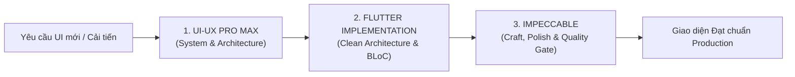

# HƯỚNG DẪN AGENT: PHỐI HỢP UI-UX PRO MAX & IMPECCABLE KHI XÂY DỰNG GIAO DIỆN (FLUTTER)

> **Tài liệu quy chuẩn dành cho AI Coding Agents** khi thiết kế, triển khai và review giao diện Mobile Flutter trong dự án **SmartSplit**.  
> Kết hợp sức mạnh kiến trúc hệ thống của **`ui-ux-pro-max`** và tay nghề trau chuốt (craftmanship) của **`impeccable`**.

---

## 1. TỔNG QUAN & PHÂN CÔNG VAI TRÒ (DUAL-SKILL SYNERGY)

Khi xây dựng bất kỳ màn hình hoặc UI Component nào trên Flutter, Agent **bắt buộc** phải tuân theo sự phân công của 2 skill:



| Tiêu chí | `ui-ux-pro-max` (Kiến trúc sư) | `impeccable` (Giám đốc Nghệ thuật & Kiểm duyệt) |
| :--- | :--- | :--- |
| **Vai trò chính** | Thiết lập Design System, tra cứu tokens, quy chuẩn UX mobile | Đảm bảo tính nhất quán, trau chuốt vi mô, loại bỏ lỗi UX vụn vặt |
| **Chế độ bề mặt** | Phân loại Category: Fintech / Split-bill / Dashboard | **Operate Mode**: Ưu tiên tính tiện dụng, tốc độ hoàn thành tác vụ, scan nhanh |
| **Công cụ & Tài nguyên** | `scripts/search.py` (Palette, Typography, UX rules) | Checklists: `craft-floor.md`, `operate.md`, `harden.md`, `polish.md` |
| **Thời điểm kích hoạt** | **Trước khi viết code** (Lập kế hoạch, chọn màu, spacing, layout) | **Trong & sau khi viết code** (Review chi tiết, viền, bóng, phản hồi, copy) |

---

## 2. NGUYÊN TẮC THIẾT KẾ DÀNH RIÊNG CHO SMARTSPLIT (FINTECH OPERATE MODE)

SmartSplit là ứng dụng chia tiền nhóm và quét hóa đơn thông minh. Toàn bộ UI tuân theo **Operate Mode** (người dùng cần nắm bắt nhanh số dư và hoàn thành chia tiền/chuyển khoản trong vài giây).

### 2.1. Bảng màu Semantic Tokens (Design System)
Không dùng mã màu Hex rời rạc (`#123456`) trong widget. Luôn tập trung tại `AppColors` / `ThemeData`:
- **Primary (Chủ đạo):** Emerald Green (`#059669` - `#10B981`) — Biểu tượng của tài chính minh bạch, đáng tin cậy.
- **Secondary (Phụ trợ):** Slate / Deep Navy (`#0F172A` - `#1E293B`) — Tạo chiều sâu và độ tương phản cao.
- **Semantic Debt (Số dư nợ):**
  - **Dương (Bạn được nhận lại tiền):** `#10B981` (Green) kèm icon mũi tên hướng lên/nhận `arrow_downward_rounded`.
  - **Âm (Bạn cần trả cho người khác):** `#EF4444` (Coral Red) kèm icon cảnh báo/mũi tên chuyển `arrow_upward_rounded`.
  - **Bằng 0 (Đã sòng phẳng):** `#64748B` (Neutral Slate).
- **Background & Surface:**
  - Light mode: Nền `#F8FAFC`, thẻ Card `#FFFFFF`, viền mờ `#E2E8F0`.
  - Tỉ lệ tương phản văn bản đạt chuẩn WCAG AA ($\ge 4.5:1$).

### 2.2. Kích thước & Nhịp điệu không gian (Spacing & Sizing)
Tuân thủ hệ số lưới 4pt/8pt của `ui-ux-pro-max`:
- **Spacing:** `4dp`, `8dp`, `12dp`, `16dp` (chuẩn padding màn hình), `24dp`, `32dp`.
- **Border Radius:**
  - `8dp`: Button nhỏ, thẻ tag/chip, badge.
  - `12dp` - `16dp`: Card danh sách, input field, hóa đơn item.
  - `24dp`: Modal Bottom Sheet (bo tròn 2 góc trên).
  - `999dp`: Nút bấm dạng Pill hoặc Avatar tròn.
- **Touch Target (Quy tắc sống còn):** Mọi nút bấm, icon bấm được phải có vùng chạm **tối thiểu $44 \times 44\,\text{dp}$** (áp dụng `IconButton(iconSize: 24, padding: EdgeInsets.all(10))`).

### 2.3. Quy chuẩn hiển thị số tiền VNĐ (Formatting)
- Luôn định dạng tiền tệ qua `NumberFormat.currency(locale: 'vi_VN', symbol: 'đ')` (ví dụ: `150.000 đ`).
- Con số quan trọng (tổng tiền bill, số dư cá nhân) dùng font chữ đậm (`FontWeight.w700`), kích thước $\ge 20\text{sp}$.

---

## 3. QUY TRÌNH 5 BƯỚC AGENT PHẢI THỰC HIỆN KHI CODE GIAO DIỆN

Mỗi khi nhận nhiệm vụ tạo màn hình hoặc component mới, Agent phải tuần tự đi qua 5 bước sau:

### 🔹 Bước 1: Tra cứu & Định hình (Shape with `ui-ux-pro-max`)
Chạy lệnh tra cứu hoặc tham khảo guidelines để xác định pattern:
```bash
# Tra cứu phong cách hoặc UX rules phù hợp
python C:\Users\Admin\.gemini\skills\ui-ux-pro-max\scripts\search.py "fintech expense split" --domain product
python C:\Users\Admin\.gemini\skills\ui-ux-pro-max\scripts\search.py "mobile touch target" --domain ux
```
- Xác định rõ: Màn hình này cần hiển thị những gì? Thành phần nào quan trọng nhất trên 1 viewport?

### 🔹 Bước 2: Dựng khung Layout theo Clean Architecture & BLoC
- Tách biệt UI ([`presentation/`](file:///D:/Nam_3/smartsplit/smartsplit_mobile/mobile)) khỏi Logic nghiệp vụ.
- Widget chia nhỏ thành các Private Sub-widgets hoặc Component tái sử dụng trong `widgets/`, tránh file view vượt quá 300 dòng.
- Tận dụng `const` constructor tối đa để giảm thiểu rebuild không cần thiết.

### 🔹 Bước 3: Thiết kế Phòng thủ 4 Trạng thái (Harden with `impeccable`)
Mọi màn hình gọi API (Danh sách nhóm, Chi tiết hóa đơn, Quét AI, Hồ sơ) **bắt buộc** phải xử lý trọn vẹn 4 trạng thái BLoC:
1. **Initial**: Trạng thái sơ khởi.
2. **Loading**: Hiển thị Shimmer/Skeleton loader (thay vì một vòng quay spinner trơ trọi giữa màn hình trắng).
3. **Success**: Hiển thị dữ liệu kèm hiệu ứng hiển thị êm ái.
   - *Nếu dữ liệu rỗng (Empty State):* Luôn có hình minh họa/icon thân thiện, dòng text giải thích và 1 nút Call-To-Action (ví dụ: *"Chưa có nhóm nào. Bấm 'Tạo nhóm mới' để bắt đầu chia tiền"*).
4. **Failure (Error State):** Hiển thị thông báo lỗi bằng Tiếng Việt rõ ràng, kèm nút **"Thử lại" (Retry)**.

### 🔹 Bước 4: Vi mô & Xúc giác (Polish with `impeccable`)
- **Haptic Feedback:** Thêm rung nhẹ (`HapticFeedback.lightImpact()`) khi bấm nút chia tiền thành công hoặc xác nhận trả nợ VietQR.
- **Bảo vệ hiển thị:** Chống lỗi `RenderFlex overflowed` bằng cách luôn bọc text linh động trong `Flexible`/`Expanded` kèm `TextOverflow.ellipsis`, bọc form trong `SingleChildScrollView` với `keyboardDismissBehavior: ScrollViewKeyboardDismissBehavior.onDrag`.
- **UX Copywriting:** Văn phong tự nhiên, súc tích, mang tính hướng dẫn tích cực (Ví dụ: *"Đang quét hóa đơn qua AI..."* thay vì *"Đang tải"*).

### 🔹 Bước 5: Kiểm duyệt lần cuối (Pre-delivery Quality Checklist)
Trước khi bàn giao code, Agent phải tự rà soát danh sách kiểm tra sau:
- [ ] Không có mã màu Hex viết trực tiếp (`Colors.white`, `AppColors.primary` thay vì `#FFFFFF`).
- [ ] Mọi tap target đều $\ge 44 \times 44\,\text{dp}$.
- [ ] Bàn phím không đè mất nút bấm (dùng `SafeArea` và `bottomNavigationBar` hợp lý).
- [ ] Định dạng ngày tháng, tiền tệ chuẩn tiếng Việt (`intl`).
- [ ] Chạy `flutter analyze` không có lỗi đỏ (Error) hay cảnh báo nghiêm trọng (Warning).

---

## 4. CODE MẪU CHUẨN MỰC (SMARTSPLIT WIDGET TEMPLATE)

Dưới đây là mẫu widget chuẩn kết hợp triệt để BLoC + UX Shimmer + Empty State + Error Handling:

```dart
import 'package:flutter/material.dart';
import 'package:flutter/services.dart';
import 'package:intl/intl.dart';
import 'package:smartsplit_mobile/core/theme/theme.dart';

class GroupBalanceCard extends StatelessWidget {
  final String groupName;
  final int netBalance; // Tiền VNĐ số nguyên
  final VoidCallback onTapSettle;

  const GroupBalanceCard({
    super.key,
    required this.groupName,
    required this.netBalance,
    required this.onTapSettle,
  });

  @override
  Widget build(BuildContext context) {
    final currencyFormatter = NumberFormat.currency(locale: 'vi_VN', symbol: 'đ');
    final isDebtor = netBalance < 0;

    // Lấy màu Semantic tokens từ AppColors (chuẩn WCAG AA)
    final Color statusColor = AppColors.getDebtColor(netBalance);
    final Color statusBg = AppColors.getDebtBgColor(netBalance);
    final Color statusText = AppColors.getDebtTextColor(netBalance);
    final String statusLabel = AppColors.getDebtStatusText(netBalance);

    return Container(
      margin: const EdgeInsets.symmetric(
        horizontal: AppSpacing.lg,
        vertical: AppSpacing.sm,
      ),
      padding: AppSpacing.cardPadding,
      decoration: BoxDecoration(
        color: AppColors.surface,
        borderRadius: AppSpacing.roundedLg,
        border: Border.all(color: AppColors.border),
        boxShadow: [
          BoxShadow(
            // Dùng .withValues(alpha: ...) thay thế hoàn toàn cho .withOpacity() đã cũ
            color: AppColors.secondary.withValues(alpha: 0.04),
            blurRadius: 8,
            offset: const Offset(0, 2),
          ),
        ],
      ),
      child: Column(
        crossAxisAlignment: CrossAxisAlignment.start,
        children: [
          Row(
            mainAxisAlignment: MainAxisAlignment.spaceBetween,
            children: [
              Expanded(
                child: Text(
                  groupName,
                  style: const TextStyle(
                    fontSize: 18,
                    fontWeight: FontWeight.w600,
                    color: AppColors.textPrimary,
                  ),
                  maxLines: 1,
                  overflow: TextOverflow.ellipsis,
                ),
              ),
              Container(
                padding: AppSpacing.badgePadding,
                decoration: BoxDecoration(
                  color: statusBg,
                  borderRadius: AppSpacing.roundedPill,
                  border: Border.all(
                    color: AppColors.getDebtBorderColor(netBalance),
                    width: 0.8,
                  ),
                ),
                child: Text(
                  statusLabel,
                  style: TextStyle(
                    color: statusText,
                    fontSize: 12,
                    fontWeight: FontWeight.w600,
                  ),
                ),
              ),
            ],
          ),
          AppSpacing.gapVerticalMd,
          Text(
            currencyFormatter.format(netBalance.abs()),
            style: TextStyle(
              fontSize: 24,
              fontWeight: FontWeight.bold,
              color: statusColor,
              letterSpacing: -0.5,
            ),
          ),
          if (isDebtor) ...[
            AppSpacing.gapVerticalLg,
            SizedBox(
              width: double.infinity,
              height: AppSpacing.buttonHeight, // Chuẩn touch target tối thiểu 48dp
              child: ElevatedButton.icon(
                onPressed: () {
                  HapticFeedback.lightImpact(); // Xúc giác nhẹ theo chuẩn Impeccable
                  onTapSettle();
                },
                icon: const Icon(Icons.qr_code_rounded, size: 20),
                label: const Text(
                  "Thanh toán ngay qua VietQR",
                  style: TextStyle(fontWeight: FontWeight.w600),
                ),
                style: ElevatedButton.styleFrom(
                  backgroundColor: AppColors.primary,
                  foregroundColor: Colors.white,
                  shape: const RoundedRectangleBorder(
                    borderRadius: AppSpacing.roundedMd,
                  ),
                  elevation: 0,
                ),
              ),
            ),
          ],
        ],
      ),
    );
  }
}
```

---

## 5. TÓM TẮT MỆNH LỆNH CHO AGENT

> ⚡ **"Trước khi code: Mở `ui-ux-pro-max` để lấy Token & Kiến trúc layout.  
> Sau khi code: Dùng `impeccable` soi từng viền, bóng, loading shimmer, lỗi overflow và copywriting tiếng Việt."**
