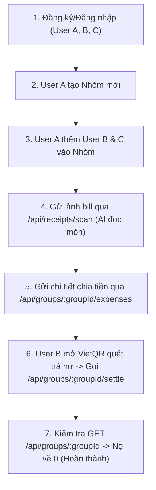

# 📘 SMARTSPLIT — TÀI LIỆU API & HƯỚNG DẪN TEST POSTMAN

Tài liệu này tổng hợp toàn bộ các RESTful API của hệ thống **SmartSplit Backend** (Express + TypeScript + MongoDB + Gemini AI) và hướng dẫn chi tiết từng bước cách cấu hình, gửi request, và kiểm thử trên **Postman**.

---

## 📑 MỤC LỤC
1. [Quy chuẩn chung & Thiết lập Postman](#1-quy-chuẩn-chung--thiết-lập-postman)
   - [Quy ước dữ liệu](#quy-ước-dữ-liệu)
   - [Định dạng Response chuẩn](#định-dạng-response-chuẩn)
   - [Thiết lập Môi trường Postman (Environment)](#thiết-lập-môi-trường-postman-environment)
   - [Tự động lưu Token (Postman Auto-Token Script)](#tự-động-lưu-token-postman-auto-token-script)
2. [Cụm API Auth & User Profile (Xác thực & Người dùng)](#2-cụm-api-auth--user-profile)
   - [POST /api/auth/register (Đăng ký)](#1-post-apiauthregister---đăng-ký-tài-khoản)
   - [POST /api/auth/login (Đăng nhập)](#2-post-apiauthlogin---đăng-nhập)
   - [PUT /api/users/profile (Cập nhật hồ sơ & ngân hàng)](#3-put-apiusersprofile---cập-nhật-hồ-sơ)
3. [Cụm API Groups (Quản lý Nhóm)](#3-cụm-api-groups)
   - [POST /api/groups (Tạo nhóm mới)](#4-post-apigroups---tạo-nhóm-mới)
   - [GET /api/groups (Lấy danh sách nhóm)](#5-get-apigroups---lấy-danh-sách-nhóm)
   - [GET /api/groups/:groupId (Chi tiết nhóm & Nợ tối giản)](#6-get-apigroupsgroupid---xem-chi-tiết-nhóm)
   - [POST /api/groups/:groupId/members (Thêm thành viên bằng Email)](#7-post-apigroupsgroupidmembers---thêm-thành-viên)
4. [Cụm API Receipt AI & Expenses (Quét Hóa đơn & Chia tiền)](#4-cụm-api-receipt-ai--expenses)
   - [POST /api/receipts/scan (Gemini Vision AI bóc tách hóa đơn)](#8-post-apireceiptsscan---ai-quét-hóa-đơn)
   - [POST /api/groups/:groupId/expenses (Lưu hóa đơn & Chia tiền Pro-rata)](#9-post-apigroupsgroupidexpenses---tạo-hóa-đơn-chia-tiền)
   - [POST /api/groups/:groupId/settle (Thanh toán trả nợ & Cập nhật số dư)](#10-post-apigroupsgroupidsettle---xác-nhận-trả-nợ)
5. [Quy tắc sinh mã VietQR](#5-quy-tắc-sinh-mã-vietqr)
6. [Kịch bản kiểm thử luồng thực tế E2E (End-to-End Walkthrough)](#6-kịch-bản-kiểm-thử-luồng-thực-tế-e2e)
7. [Các lỗi thường gặp & Cách khắc phục](#7-các-lỗi-thường-gặp--cách-khắc-phục)

---

## 1. QUY CHUẨN CHUNG & THIẾT LẬP POSTMAN

### Quy ước dữ liệu
- **Base URL:** `http://localhost:3000` (hoặc `http://10.0.2.2:3000` đối với Android Emulator).
- **Tiền tệ:** Luôn là số nguyên VNĐ (`Integer`), ví dụ: `150000` (không dùng số thực `150000.50`).
- **Header mặc định cho JSON:**
  ```http
  Content-Type: application/json
  ```
- **Header xác thực (đối với API yêu cầu đăng nhập):**
  ```http
  Authorization: Bearer <accessToken>
  ```

### Định dạng Response chuẩn

#### 1. Khi thành công (HTTP Status 200 / 201):
```json
{
  "success": true,
  "message": "Thao tác thành công",
  "data": { ... }
}
```

#### 2. Khi gặp lỗi (HTTP Status 400 / 401 / 404 / 500):
```json
{
  "success": false,
  "message": "Mô tả chi tiết nguyên nhân lỗi",
  "errorCode": "VALIDATION_ERROR | UNAUTHORIZED | NOT_FOUND | INTERNAL_SERVER_ERROR",
  "errors": [
    {
      "field": "email",
      "message": "Email không hợp lệ"
    }
  ]
}
```

---

### Thiết lập Môi trường Postman (Environment)

Để không phải copy/paste token và ID bằng tay giữa các request, hãy tạo một **Environment** trên Postman (VD đặt tên là `SmartSplit Local`):

| Variable (Tên biến) | Initial Value | Current Value | Ghi chú |
|---|---|---|---|
| `baseUrl` | `http://localhost:3000` | `http://localhost:3000` | Địa chỉ máy chủ Backend |
| `accessToken` | *(để trống)* | *(sẽ tự động điền)* | JWT Token của người dùng |
| `groupId` | *(để trống)* | *(sẽ điền sau khi tạo nhóm)* | ID nhóm đang thao tác |
| `userId` | *(để trống)* | *(sẽ điền khi đăng nhập)* | ID người dùng hiện tại |

---

### Tự động lưu Token (Postman Auto-Token Script)

Tại Request **Đăng nhập (Login)** hoặc **Đăng ký (Register)** trên Postman, hãy chuyển sang tab **Scripts** (hoặc **Tests**) và dán đoạn code JavaScript sau:

```javascript
// Tự động trích xuất accessToken và lưu vào biến môi trường Postman
if (pm.response.code === 200 || pm.response.code === 201) {
    var response = pm.response.json();
    if (response.data && response.data.accessToken) {
        pm.environment.set("accessToken", response.data.accessToken);
        console.log("✅ Đã tự động lưu accessToken vào Postman Environment!");
    }
    if (response.data && response.data.user && response.data.user._id) {
        pm.environment.set("userId", response.data.user._id);
        console.log("✅ Đã tự động lưu userId: " + response.data.user._id);
    }
}
```

> **Cách dùng Token ở các Request sau:**
> Vào tab **Authorization** của Request $\rightarrow$ Chọn Type: **Bearer Token** $\rightarrow$ Nhập `{{accessToken}}` vào ô Token.

---

## 2. CỤM API AUTH & USER PROFILE

### 1. `POST /api/auth/register` - Đăng ký tài khoản

Đăng ký tài khoản mới kèm thông tin tài khoản ngân hàng Napas (phục vụ tự sinh mã VietQR).

- **Method:** `POST`
- **URL:** `{{baseUrl}}/api/auth/register` (hoặc `{{baseUrl}}/api/register`)
- **Auth:** `No Auth`
- **Headers:** `Content-Type: application/json`
- **Body (`raw` $\rightarrow$ `JSON`):**
```json
{
  "name": "Huỳnh Đăng",
  "email": "dang@gmail.com",
  "password": "Password123!",
  "bankInfo": {
    "bankBin": "970436",
    "bankShortName": "Vietcombank",
    "accountNo": "1012345678",
    "accountName": "HUYNH DANG"
  }
}
```
*(Trường `bankInfo` là không bắt buộc, có thể bỏ qua nếu người dùng chưa muốn nhập).*

- **Response Mẫu (HTTP 201 Created):**
```json
{
  "success": true,
  "message": "Đăng ký thành công",
  "data": {
    "accessToken": "eyJhbGciOiJIUzI1NiIsInR5cCI6IkpXVCJ9...",
    "user": {
      "_id": "672f10a8b432a1001e7a9123",
      "name": "Huỳnh Đăng",
      "email": "dang@gmail.com",
      "bankInfo": {
        "bankBin": "970436",
        "bankShortName": "Vietcombank",
        "accountNo": "1012345678",
        "accountName": "HUYNH DANG"
      },
      "createdAt": "2026-11-09T07:15:00.000Z"
    }
  }
}
```

- **Lỗi thường gặp:**
  - `400 BAD_REQUEST`: `"Email đã được sử dụng"` (khi đăng ký email đã tồn tại).
  - `400 VALIDATION_ERROR`: Mật khẩu dưới 6 ký tự hoặc email sai cú pháp.

---

### 2. `POST /api/auth/login` - Đăng nhập

Xác thực email/mật khẩu và nhận Token JWT 7 ngày.

- **Method:** `POST`
- **URL:** `{{baseUrl}}/api/auth/login` (hoặc `{{baseUrl}}/api/login`)
- **Auth:** `No Auth`
- **Headers:** `Content-Type: application/json`
- **Body (`raw` $\rightarrow$ `JSON`):**
```json
{
  "email": "dang@gmail.com",
  "password": "Password123!"
}
```

- **Response Mẫu (HTTP 200 OK):**
```json
{
  "success": true,
  "message": "Đăng nhập thành công",
  "data": {
    "accessToken": "eyJhbGciOiJIUzI1NiIsInR5cCI6IkpXVCJ9...",
    "user": {
      "_id": "672f10a8b432a1001e7a9123",
      "name": "Huỳnh Đăng",
      "email": "dang@gmail.com",
      "avatarUrl": null,
      "bankInfo": {
        "bankBin": "970436",
        "bankShortName": "Vietcombank",
        "accountNo": "1012345678",
        "accountName": "HUYNH DANG"
      },
      "createdAt": "2026-11-09T07:15:00.000Z"
    }
  }
}
```

- **Lỗi thường gặp:**
  - `401 UNAUTHORIZED`: `"Email hoặc mật khẩu không chính xác"`.

---

### 3. `PUT /api/users/profile` - Cập nhật hồ sơ

Cập nhật họ tên, ảnh đại diện hoặc tài khoản ngân hàng nhận tiền.

- **Method:** `PUT`
- **URL:** `{{baseUrl}}/api/users/profile`
- **Auth:** `Bearer Token` $\rightarrow$ `{{accessToken}}`
- **Headers:** `Content-Type: application/json`
- **Body (`raw` $\rightarrow$ `JSON`):**
```json
{
  "name": "Huỳnh Hải Đăng",
  "avatarUrl": "https://i.pravatar.cc/300?img=12",
  "bankInfo": {
    "bankBin": "970422",
    "bankShortName": "MBBank",
    "accountNo": "0987654321",
    "accountName": "HUYNH HAI DANG"
  }
}
```

- **Response Mẫu (HTTP 200 OK):**
```json
{
  "success": true,
  "message": "Cập nhật hồ sơ thành công",
  "data": {
    "user": {
      "_id": "672f10a8b432a1001e7a9123",
      "name": "Huỳnh Hải Đăng",
      "email": "dang@gmail.com",
      "avatarUrl": "https://i.pravatar.cc/300?img=12",
      "bankInfo": {
        "bankBin": "970422",
        "bankShortName": "MBBank",
        "accountNo": "0987654321",
        "accountName": "HUYNH HAI DANG"
      },
      "createdAt": "2026-11-09T07:15:00.000Z"
    }
  }
}
```

---

## 3. CỤM API GROUPS

### 4. `POST /api/groups` - Tạo nhóm mới

Người tạo nhóm tự động trở thành thành viên đầu tiên với số dư `netBalance = 0`.

- **Method:** `POST`
- **URL:** `{{baseUrl}}/api/groups`
- **Auth:** `Bearer Token` $\rightarrow$ `{{accessToken}}`
- **Headers:** `Content-Type: application/json`
- **Body (`raw` $\rightarrow$ `JSON`):**
```json
{
  "name": "Chuyến đi Đà Lạt 3N2Đ",
  "description": "Nhóm chia tiền phòng khách sạn và ăn uống"
}
```

- **Response Mẫu (HTTP 201 Created):**
```json
{
  "success": true,
  "message": "Tạo nhóm thành công",
  "data": {
    "group": {
      "_id": "672f22b1c810b2002f8b1001",
      "name": "Chuyến đi Đà Lạt 3N2Đ",
      "description": "Nhóm chia tiền phòng khách sạn và ăn uống",
      "createdBy": "672f10a8b432a1001e7a9123",
      "members": [
        {
          "userId": "672f10a8b432a1001e7a9123",
          "netBalance": 0
        }
      ],
      "simplifiedDebts": [],
      "createdAt": "2026-11-09T08:00:00.000Z",
      "updatedAt": "2026-11-09T08:00:00.000Z"
    }
  }
}
```

> **Mẹo Postman:** Bạn có thể lưu ID nhóm vào biến môi trường bằng script Tests:
> `pm.environment.set("groupId", pm.response.json().data.group._id);`

---

### 5. `GET /api/groups` - Lấy danh sách nhóm

Trả về tất cả các nhóm mà người dùng hiện tại là thành viên.

- **Method:** `GET`
- **URL:** `{{baseUrl}}/api/groups`
- **Auth:** `Bearer Token` $\rightarrow$ `{{accessToken}}`
- **Response Mẫu (HTTP 200 OK):**
```json
{
  "success": true,
  "message": "Lấy danh sách nhóm thành công",
  "data": {
    "groups": [
      {
        "_id": "672f22b1c810b2002f8b1001",
        "name": "Chuyến đi Đà Lạt 3N2Đ",
        "description": "Nhóm chia tiền phòng khách sạn và ăn uống",
        "memberCount": 3,
        "myNetBalance": 120000,
        "updatedAt": "2026-11-09T08:30:00.000Z"
      }
    ]
  }
}
```

---

### 6. `GET /api/groups/:groupId` - Xem chi tiết nhóm

Lấy đầy đủ thông tin: Danh sách thành viên (kèm avatar/tên), các khoản nợ đã tối giản (`simplifiedDebts` kèm thông tin tài khoản ngân hàng để quét QR), và lịch sử các hóa đơn.

- **Method:** `GET`
- **URL:** `{{baseUrl}}/api/groups/{{groupId}}`
- **Auth:** `Bearer Token` $\rightarrow$ `{{accessToken}}`
- **Response Mẫu (HTTP 200 OK):**
```json
{
  "success": true,
  "message": "Lấy chi tiết nhóm thành công",
  "data": {
    "group": {
      "_id": "672f22b1c810b2002f8b1001",
      "name": "Chuyến đi Đà Lạt 3N2Đ",
      "members": [
        {
          "userId": {
            "_id": "672f10a8b432a1001e7a9123",
            "name": "Huỳnh Đăng",
            "email": "dang@gmail.com",
            "avatarUrl": null
          },
          "netBalance": 70000
        },
        {
          "userId": {
            "_id": "672f10a8b432a1001e7a9456",
            "name": "Bình Nguyễn",
            "email": "binh@gmail.com",
            "avatarUrl": null
          },
          "netBalance": -70000
        }
      ],
      "simplifiedDebts": [
        {
          "fromUser": {
            "_id": "672f10a8b432a1001e7a9456",
            "name": "Bình Nguyễn"
          },
          "toUser": {
            "_id": "672f10a8b432a1001e7a9123",
            "name": "Huỳnh Đăng",
            "bankInfo": {
              "bankBin": "970436",
              "bankShortName": "Vietcombank",
              "accountNo": "1012345678",
              "accountName": "HUYNH DANG"
            }
          },
          "amount": 70000
        }
      ]
    }
  }
}
```

---

### 7. `POST /api/groups/:groupId/members` - Thêm thành viên

Thêm thành viên mới vào nhóm bằng email của họ. Thành viên mới bắt đầu với `netBalance = 0`.

- **Method:** `POST`
- **URL:** `{{baseUrl}}/api/groups/{{groupId}}/members`
- **Auth:** `Bearer Token` $\rightarrow$ `{{accessToken}}`
- **Headers:** `Content-Type: application/json`
- **Body (`raw` $\rightarrow$ `JSON`):**
```json
{
  "email": "binh@gmail.com"
}
```

- **Response Mẫu (HTTP 200 OK):**
```json
{
  "success": true,
  "message": "Thêm thành viên vào nhóm thành công",
  "data": {
    "group": {
      "_id": "672f22b1c810b2002f8b1001",
      "members": [ ... ]
    }
  }
}
```

- **Lỗi thường gặp:**
  - `404 NOT_FOUND`: Không tìm thấy user có email này trong hệ thống.
  - `400 BAD_REQUEST`: Người dùng đã là thành viên của nhóm.

---

## 4. CỤM API RECEIPT AI & EXPENSES

### 8. `POST /api/receipts/scan` - AI Quét hóa đơn

Upload ảnh hóa đơn lên để **Gemini Vision AI** tự động đọc tên món, đơn giá, số lượng, tiền thuế VAT, phí dịch vụ và giảm giá.

- **Method:** `POST`
- **URL:** `{{baseUrl}}/api/receipts/scan`
- **Auth:** `Bearer Token` $\rightarrow$ `{{accessToken}}`
- **Headers:** *(Không tự gõ Header `Content-Type`, Postman sẽ tự động sinh multipart boundary)*
- **Body (`form-data`):**
  - Chuyển con trỏ chuột vào cột **KEY** $\rightarrow$ chọn kiểu **File** (thay vì Text).
  - Tên trường (Key): `receipt`
  - Giá trị (Value): Chọn file ảnh hóa đơn từ máy tính (`.jpg`, `.png`, `.webp`, `.heic`, tối đa 5MB).

```
KEY        | TYPE | VALUE
-----------|------|-------------------------
receipt    | File | [Chọn ảnh hoa_don.jpg]
```

- **Response Mẫu (HTTP 200 OK):**
```json
{
  "success": true,
  "message": "Bóc tách hóa đơn thành công",
  "data": {
    "merchantName": "Gogi House Vạn Hạnh Mall",
    "items": [
      {
        "id": "c62dbbf6-96ea-45a8-b649-16a750c18401",
        "name": "Combo Ba chỉ bò Mỹ sốt Galbi",
        "quantity": 2,
        "unitPrice": 189000,
        "totalPrice": 378000
      },
      {
        "id": "e44caad2-51ab-40a9-b631-f9b626d70102",
        "name": "Canh kim chi thịt heo",
        "quantity": 1,
        "unitPrice": 89000,
        "totalPrice": 89000
      },
      {
        "id": "a11dff11-12ef-4011-8899-77a880d90303",
        "name": "Khăn lạnh",
        "quantity": 3,
        "unitPrice": 5000,
        "totalPrice": 15000
      }
    ],
    "extraCharges": {
      "tax": 38560,
      "serviceCharge": 24100,
      "discount": 50000
    },
    "subtotalAmount": 482000,
    "totalAmount": 494660,
    "calculatedTotal": 494660,
    "isDiscrepancy": false
  }
}
```

> **Lưu ý:**
> - API này **chưa ghi vào Database**, chỉ trả kết quả JSON để người dùng kiểm tra trên màn hình `SplitWorkspaceScreen` và chọn ai ăn món nào.
> - `isDiscrepancy: true` nếu tổng tiền món cộng phụ phí bị lệch so với số tiền in dưới đáy hóa đơn (giúp app Flutter hiển thị banner màu cam cảnh báo).

---

### 9. `POST /api/groups/:groupId/expenses` - Tạo hóa đơn chia tiền

Lưu hóa đơn vào nhóm. Backend sẽ chạy thuật toán phân bổ **Pro-rata**, làm tròn số nguyên VNĐ, xử lý sai số $\Delta$, ghi nhận vào sổ nợ và chạy thuật toán tham lam **Greedy Debt Simplification** để rút gọn nợ chéo.

- **Method:** `POST`
- **URL:** `{{baseUrl}}/api/groups/{{groupId}}/expenses`
- **Auth:** `Bearer Token` $\rightarrow$ `{{accessToken}}`
- **Headers:** `Content-Type: application/json`
- **Body (`raw` $\rightarrow$ `JSON`):**
```json
{
  "title": "Ăn trưa Gogi House",
  "paidBy": "672f10a8b432a1001e7a9123",
  "items": [
    {
      "name": "Combo Ba chỉ bò Mỹ",
      "quantity": 1,
      "unitPrice": 300000,
      "totalPrice": 300000,
      "assignedTo": [
        "672f10a8b432a1001e7a9123",
        "672f10a8b432a1001e7a9456"
      ]
    },
    {
      "name": "Canh rong biển",
      "quantity": 1,
      "unitPrice": 60000,
      "totalPrice": 60000,
      "assignedTo": [
        "672f10a8b432a1001e7a9456"
      ]
    }
  ],
  "extraCharges": {
    "tax": 36000,
    "serviceCharge": 0,
    "discount": 20000
  },
  "totalAmount": 376000
}
```

- **Response Mẫu (HTTP 201 Created):**
```json
{
  "success": true,
  "message": "Lưu hóa đơn và phân bổ chi phí thành công",
  "data": {
    "expense": {
      "_id": "672f33c9e990c3003a9c2002",
      "groupId": "672f22b1c810b2002f8b1001",
      "title": "Ăn trưa Gogi House",
      "type": "BILL",
      "paidBy": "672f10a8b432a1001e7a9123",
      "subtotalAmount": 360000,
      "totalAmount": 376000,
      "memberShares": [
        {
          "userId": "672f10a8b432a1001e7a9123",
          "baseAmount": 150000,
          "extraAmount": 6667,
          "finalAmount": 156667
        },
        {
          "userId": "672f10a8b432a1001e7a9456",
          "baseAmount": 210000,
          "extraAmount": 9333,
          "finalAmount": 219333
        }
      ],
      "createdAt": "2026-11-09T09:15:00.000Z"
    },
    "simplifiedDebts": [
      {
        "fromUser": "672f10a8b432a1001e7a9456",
        "toUser": "672f10a8b432a1001e7a9123",
        "amount": 219333
      }
    ]
  }
}
```

---

### 10. `POST /api/groups/:groupId/settle` - Xác nhận trả nợ

Được gọi khi một thành viên chuyển khoản trả nợ cho người khác. Hệ thống sẽ tạo một bản ghi Expense loại `SETTLEMENT` và tự động cập nhật giảm số dư nợ `netBalance`.

- **Method:** `POST`
- **URL:** `{{baseUrl}}/api/groups/{{groupId}}/settle`
- **Auth:** `Bearer Token` $\rightarrow$ `{{accessToken}}`
- **Headers:** `Content-Type: application/json`
- **Body (`raw` $\rightarrow$ `JSON`):**
```json
{
  "fromUser": "672f10a8b432a1001e7a9456",
  "toUser": "672f10a8b432a1001e7a9123",
  "amount": 219333
}
```

- **Response Mẫu (HTTP 200 OK):**
```json
{
  "success": true,
  "message": "Xác nhận trả nợ thành công",
  "data": {
    "settlement": {
      "_id": "672f44dfe110a4004b0d3003",
      "groupId": "672f22b1c810b2002f8b1001",
      "title": "Thanh toán nợ cho Huỳnh Đăng",
      "type": "SETTLEMENT",
      "paidBy": "672f10a8b432a1001e7a9456",
      "totalAmount": 219333
    },
    "updatedSimplifiedDebts": []
  }
}
```

---

## 5. QUY TẮC SINH MÃ VIETQR

Khi ứng dụng Flutter hiển thị màn hình thanh toán nợ cho khoản `{ fromUser, toUser, amount }`:
1. Lấy thông tin `toUser.bankInfo` (`bankBin`, `accountNo`, `accountName`).
2. Sinh trực tiếp đường link ảnh VietQR chuẩn Napas:

```text
https://img.vietqr.io/image/{bankBin}-{accountNo}-compact2.png?amount={amount}&addInfo={addInfo}&accountName={accountName}
```

### Ví dụ cụ thể:
- `bankBin`: `970436` (Vietcombank)
- `accountNo`: `1012345678`
- `amount`: `219333`
- `accountName`: `HUYNH%20DANG` (URL Encoded)
- `addInfo`: `SmartSplit%20Binh%20thanh%20toan%20nhom%20Da%20Lat`

🔗 **Link hoàn chỉnh hiển thị trên Mobile:**
```text
https://img.vietqr.io/image/970436-1012345678-compact2.png?amount=219333&addInfo=SmartSplit%20Binh%20thanh%20toan%20nhom%20Da%20Lat&accountName=HUYNH%20DANG
```
*(Người dùng mở ứng dụng ngân hàng bất kỳ, quét ảnh này là toàn bộ số tiền và nội dung chuyển khoản được tự động điền chính xác 100%).*

---

## 6. KỊCH BẢN KIỂM THỬ LUỒNG THỰC TẾ E2E

Bạn có thể chạy thử quy trình từ đầu đến cuối trên Postman theo 6 bước:



1. **Bước 1 (Đăng ký tài khoản):**
   - Đăng ký `User A` (`dang@gmail.com`) kèm `bankInfo`.
   - Đăng ký `User B` (`binh@gmail.com`).
   - Đăng nhập `User A` $\rightarrow$ Postman tự động lưu `accessToken`.
2. **Bước 2 (Tạo nhóm):**
   - Gọi `POST /api/groups` với tên "Lẩu Kichi Kichi".
   - Lưu `groupId` nhận được.
3. **Bước 3 (Thêm bạn bè):**
   - Gọi `POST /api/groups/{{groupId}}/members` với email `binh@gmail.com`.
4. **Bước 4 (Scan Bill bằng AI):**
   - Chọn một ảnh hóa đơn mẫu trong máy.
   - Gọi `POST /api/receipts/scan` với field `receipt` (form-data).
   - Xem kết quả JSON do Gemini AI bóc tách.
5. **Bước 5 (Lưu hóa đơn chia tiền):**
   - Gọi `POST /api/groups/{{groupId}}/expenses`.
   - Gán món ăn cho User A và User B.
   - Nhận danh sách nợ `simplifiedDebts`.
6. **Bước 6 (Trả nợ & Triệt tiêu nợ):**
   - Đăng nhập tài khoản `User B` $\rightarrow$ Lấy token của User B.
   - Gọi `POST /api/groups/{{groupId}}/settle` trả nợ cho User A.
   - Kiểm tra lại `GET /api/groups/{{groupId}}` thấy nợ đã được triệt tiêu hoàn toàn!

---

## 7. CÁC LỖI THƯỜNG GẶP & CÁCH KHẮC PHỤC

| Mã Lỗi | Nguyên nhân | Cách khắc phục trên Postman |
|---|---|---|
| **`401 UNAUTHORIZED`** | Chưa đăng nhập hoặc token hết hạn | Chạy lại request `POST /api/auth/login` để lấy token mới. Đảm bảo tab **Authorization** đã chọn `Bearer Token` với biến `{{accessToken}}`. |
| **`400 VALIDATION_ERROR`** | Request Body thiếu trường bắt buộc hoặc sai định dạng | Kiểm tra trường `errors` trong JSON trả về. Ví dụ: password < 6 ký tự, email không đúng định dạng RFC, hoặc số tiền âm. |
| **`400 MulterError / File Error`** | Tên field upload file không phải là `receipt` hoặc file vượt quá 5MB | Trong tab **Body $\rightarrow$ form-data**, đảm bảo cột **KEY** ghi chính xác là `receipt` và chọn kiểu **File**; file ảnh không nặng quá 5MB. |
| **`404 NOT_FOUND`** | Sai URL hoặc ID không tồn tại | Kiểm tra xem URL có chứa `/api/` không; kiểm tra `{{groupId}}` có đúng ID trong MongoDB không. |
| **`Could not send request / ECONNREFUSED`** | Server Backend chưa khởi động | Mở terminal chạy `cd smartsplit_mobile/backend && npm run dev` (hoặc `npx tsx src/index.ts`). |
